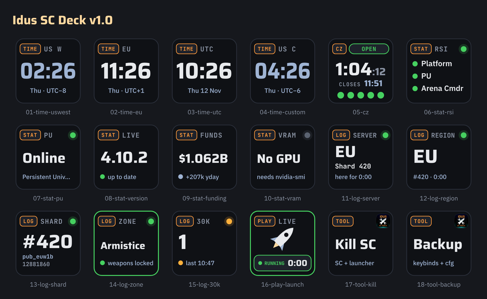
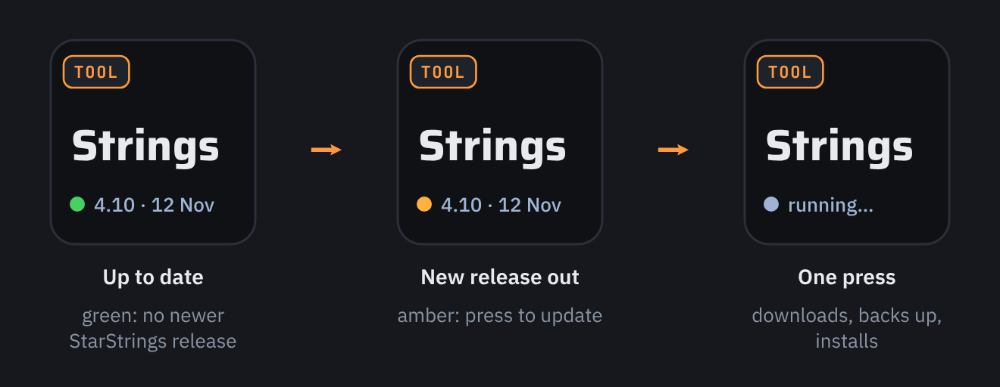

# Idus SC Deck

Star Citizen keys for **[OpenDeck](https://github.com/nekename/OpenDeck)** (Stream Deck on Linux) and the **Elgato Stream Deck app on Windows**, in the Idus look: dark keys, status shown by colour *and* shape, and an orange tab on every key that names its family.



> [!TIP]
> **StarStrings on one key — built in, on Linux and Windows.**
> The **TOOL · StarStrings** key shows which game version your [StarStrings](https://github.com/MrKraken/StarStrings) were made for and when you installed them, and turns amber as soon as a newer release is out. One press downloads the newest release, keeps your old `global.ini`, installs the new one and adds the `user.cfg` line — no browser, no unzipping, no copying into the game folder. Not installed yet? The key says *tap to install*.
>
> 
>
> On Linux, **[Idus SC Toolbox](https://github.com/Idus/idus-sc-toolbox)** — a free, separate app for Star Citizen (KDE Plasma 6) and a companion to the [LUG Helper](https://github.com/starcitizen-lug/lug-helper) — adds the other TOOL keys: stop a hung game, restart or patch the launcher, back up and restore keybinds, clear shaders and put the windows back on the main screen — and **PLAY · Launch** checks for a newer RSI Launcher before it starts. **[Get Idus SC Toolbox →](https://github.com/Idus/idus-sc-toolbox)**

| Family | Key | What it shows | Press |
|---|---|---|---|
| **TIME** | Server Clock | The time in a server region — US W, US E, EU, Asia, Australia, your own or any city you pick — or **UTC** with the date, which patches and events are announced in. Amber = local evening, blue = night (by the clock, not live load) | — |
| **CZ** | Exec Hangar | The Contested Zone executive hangar on **one** key: open/closed, countdown, the clock time of the next change and the five door lights | Re-syncs |
| **STAT** | Status & Stats | One key, four views: **status** — RSI Platform, PU and Arena Commander, all three or one service with an open incident's title; **version** — installed game version with a green dot when it matches the newest release notes and amber when a newer one is out, orange lamp = patched since you last looked; **funding** — crowdfunding total and yesterday's amount; **VRAM** — GPU memory in use and the biggest other program, amber above 85 % (NVIDIA) | Status: opens [status.robertsspaceindustries.com](https://status.robertsspaceindustries.com/) · Version: marks it as seen and opens the release notes · others: refresh |
| **LOG** | Game.log | From your own `Game.log`, one view per key: **server** (region + shard + time there), **region**, **shard**, **Armistice zone** (green frame = weapons locked, amber = outside) or **30K** (unexpected disconnects this session; your own quits and AFK don't count) | Refreshes |
| **PLAY** | Launch | The Idus rocket with an orange **▶ LAUNCH** plate; green **RUNNING** with the session time while the game runs | Starts the game |
| **TOOL** | Toolbox Action (Linux) · SC Tools (Windows) | Linux: one [Idus SC Toolbox](https://github.com/Idus/idus-sc-toolbox) action — kill, restart launcher, patch/verify, backup, restore, shaders, fix windows — plus **StarStrings**, built in (no Toolbox needed). Windows: the same tools built in — kill, restart launcher, backup, restore, shaders, StarStrings | Runs it — kill, restart, patch and restore take three presses: **Really?** → **Sure?** → run |

## Requirements

**Linux**
- **OpenDeck** 2.x — native package or Flatpak.
- **Node.js 22 or newer** (`sudo pacman -S nodejs` on Arch/CachyOS). OpenDeck starts the plugin with your system `node`.
- For **PLAY**, the **STAT** version view, **LOG** and **TOOL**: Star Citizen installed with [LUG Helper](https://github.com/starcitizen-lug/lug-helper). The game folder is read from LUG's config, or set it in the key's settings.
- For the **STAT** VRAM view: an NVIDIA card (`nvidia-smi`).
- Optional: [Idus SC Toolbox](https://github.com/Idus/idus-sc-toolbox) for the TOOL keys (StarStrings works without it) and the launcher update check on PLAY.

**Windows**
- **Elgato Stream Deck app 7.1 or newer** (it brings its own Node.js) on Windows 10 or 11.
- Star Citizen installed with the RSI Launcher. The game folder is found on its own (Program Files or other drives), or set it in the key's settings.
- Nothing else: no fonts to install, and the TOOL keys have the tools built in.

## Install on Linux (OpenDeck)

One line (downloads the latest release):

```bash
curl -fsSL https://github.com/Idus/idus-sc-deck/releases/latest/download/install-idus-sc-deck.sh | bash
```

Or from a clone: `bash install-idus-sc-deck.sh`. Or let **[Idus GitHub Updater](https://github.com/Idus/idus-github-updater)** (v1.5 or newer) install it and keep it up to date — it is in its list of Idus apps. Then **quit OpenDeck from its tray icon** and start it again. The keys are under **Idus SC Deck** in the action list, in family order: TIME, CZ, STAT, LOG, PLAY, TOOL.

The installer copies the plugin to `~/.config/opendeck/plugins/se.wolfpack.idusscdeck.sdPlugin` (or the Flatpak equivalent) and fetches the Idus fonts (Saira, IBM Plex Sans, JetBrains Mono) to `~/.local/share/fonts/idus` if they are missing.

## Install on Windows (Elgato Stream Deck)

Download **`se.wolfpack.idusscdeck.streamDeckPlugin`** from the [latest release](https://github.com/Idus/idus-sc-deck/releases/latest) and double-click it — the Stream Deck app installs it. The keys are under **Idus SC Deck**. (Coming to the Elgato Marketplace.)

On Windows the **TOOL · SC Tools** key does the work itself:
- **Kill SC / Restart launcher** — stops Star Citizen and the RSI Launcher (and starts the launcher again).
- **Back up / Restore** — keybinds and settings (`user` folder without shader caches, and `USER.cfg`) to `Documents\SC-backups`, or `%LOCALAPPDATA%\Idus SC Deck\SC-backups` if Documents can't be written. Restore only with the game closed, after a safety copy.
- **Clear shaders** — the caches in `%LOCALAPPDATA%\Star Citizen`.
- **StarStrings** — downloads the newest release, keeps the old `global.ini`, adds `g_language = english` to `user.cfg`. Not installed yet? The key says *tap to install*, and the first install opens the StarStrings guide and the game folder.

The Windows build is made from the same code: `node dev/build-elgato.cjs` (see `dev/README.md`).

## The keys in more detail

**TIME · Server Clock** — one key per region side by side. EU servers are in Belgium (Google Cloud europe-west1, seen in real logs), so EU shows Central European time. The digits are coloured by the region's own clock: 17–22 evening, usually the busiest time (amber), 23–06 night (blue-grey), daytime white — this is the clock, not live server data; RSI does not publish load per region. The **UTC** key stays white and shows the date. **Pick a city…** lets you choose any other place from a list (part of the world → city), no time-zone codes to type.

**STAT · version view** compares what is installed with the newest version RSI has posted release notes for in its public [Patch Notes forum](https://robertsspaceindustries.com/spectrum/community/SC/forum/190048): LIVE by version number, PTU by build number. Green dot = up to date, amber = a newer version is out. Only the RSI Launcher knows for certain (it asks RSI with your login), so this is the public estimate — a LIVE hotfix that keeps the version number is not seen.

**CZ · Exec Hangar** follows the in-game panel: closed = five red lights, one turns green every 24 minutes; open = five green, one goes dark every 12 minutes; the last five minutes are CLOSING. Pick **cztimer.com** or **exec.xyxyll.com** as the primary timer — the other is the fallback, then the last good copy on disk, then built-in values. It syncs every 15 minutes.

**LOG · Game.log** reads Star Citizen's own `Game.log` on your PC (read-only, nothing leaves the machine). Pick the view per key and put several side by side:
- `<Join PU> … shard[pub_euw1b_12881860_420]` → region **EU**, shard **#420**;
- `Context Establisher Done … gamerules="SC_Default"` / `"SC_Frontend"` → in the game world or in the menu;
- "Entering / Leaving Armistice Zone" → **Zone**;
- `<Channel Disconnected> cause=…` in the game world → **30K**, except 30016 (your quit), 30028 (AFK) and 30010 (routine menu teardown).

The game replaces `Game.log` at every start; the keys follow the new file automatically and count from zero.

**TOOL · StarStrings** (built in, no Toolbox needed) shows the game version the installed StarStrings were made for and the install date (e.g. "4.10 · 8 Nov") — StarStrings has no release number inside its file. A press installs the newest release, keeps the old `global.ini` as `global.ini.BAK-<date>` and adds `g_language = english` to `user.cfg` if it is missing; the first install also opens the StarStrings guide and the game folder. Green dot = no newer release on GitHub; amber = a newer release exists or the strings are for an older patch. The newest release is checked at most every 6 hours.

**PLAY · Launch** starts the game the best way it can find: a custom command if you set one; otherwise `idus-sc-toolbox --launch` if Idus SC Toolbox is installed (it checks for a newer RSI Launcher first); otherwise LUG Helper's `sc-launch.sh`. You can put your own image above the button — only use images you have the right to use.

## What it connects to

Nothing else, no telemetry. The plugin reads:
- `status.robertsspaceindustries.com/index.json` — every 2 minutes while a STAT key shows status;
- RSI's public crowdfunding stats — every 15 minutes while a STAT key shows funding;
- the thread titles in RSI's Patch Notes forum on Spectrum — every 30 minutes while a STAT key shows the version;
- `cztimer.com` / `exec.xyxyll.com` — every 15 minutes while an Exec Hangar key is visible.

It identifies itself as `Idus-SC-Deck (+https://github.com/Idus/idus-sc-deck)`. Local state (last timer sync, last seen version) is kept in `~/.local/state/idus-sc-deck/`.

## Uninstall

```bash
bash install-idus-sc-deck.sh --uninstall
```

## Credits

- The Contested Zone cycle math and light table are adapted from **[CZ Timer for OpenDeck](https://github.com/NyleGarcia/cztimer-opendeck)** by Nyle Garcia (MIT) — see `THIRD_PARTY_NOTICES.md`. Go try his plugin too.
- Timer data from **[cztimer.com](https://cztimer.com/)** and **[exec.xyxyll.com](https://exec.xyxyll.com/)**.
- `Game.log` line formats cross-checked with **[QuantumWake](https://github.com/gOOvER/QuantumWake)** and **[sc-log-tracker](https://github.com/DefaultHahn/sc-log-tracker)**.
- Built for **[OpenDeck](https://github.com/nekename/OpenDeck)** by nekename.
- Code written with AI assistance (Claude).

## Support

If this saves you a few clicks: **[☕ Tip me on Ko-fi](https://ko-fi.com/N4N2QZHKK)**

New to Star Citizen? Use my referral code when you enlist — you get 5,000 free aUEC to start:
**`STAR-2GDF-FDKH`** → https://www.robertsspaceindustries.com/enlist?referral=STAR-2GDF-FDKH

## License

MIT — see `LICENSE`. Third-party notices in `se.wolfpack.idusscdeck.sdPlugin/THIRD_PARTY_NOTICES.md`.

*Unofficial Star Citizen fan project, not affiliated with the Cloud Imperium group of companies. Star Citizen® and Roberts Space Industries® are trademarks of Cloud Imperium Rights LLC.*
